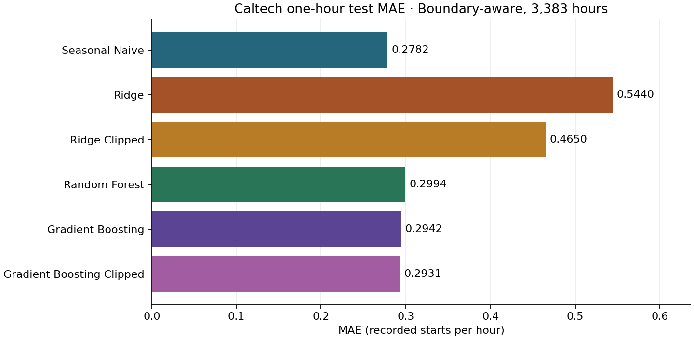
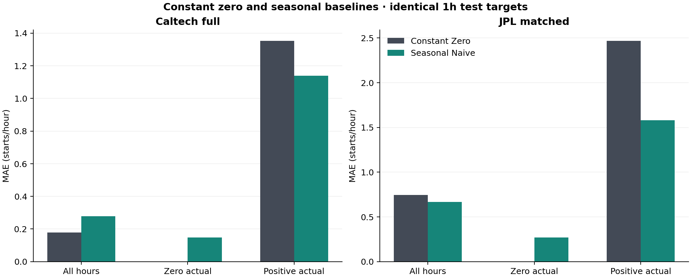

# Multi-Horizon and Cross-Site Electric Vehicle Charging Demand Forecasting

This repository studies archived EV charging records from Caltech and JPL. **Stage 3 is complete:** it forecasts the number of records starting per hour at 1, 3, 6 and 24-hour horizons, with matched same-site and bidirectional cross-site experiments, demand-group analysis, adaptive combinations and prediction intervals.

The Stage 3 publication contains source code, configurations, research reports, exact metric tables, figures and one-hour predictions. Full prediction inventories for later experiments remain outside Git; see [data and reproduction](docs/data-and-repro.md). Existing Stage 4 files are partial and are outside this release's validation scope.

## Start here

- [Stage 3 running and verification instructions](3/README.md)
- [Stage 3 research index](3/reports/STAGE3_RESEARCH_INDEX.md)
- [Final research report](3/reports/STAGE3_FINAL_REPORT.md)
- [Data, provenance and reproduction levels](docs/data-and-repro.md)
- [Historical Stage 2 results](docs/stage2-legacy.md)
- [Publication manifest](docs/artifact-index.csv) and [local-only artifact catalogue](docs/external-artifacts.csv)

## Target and protocol

Source sites are `Caltech/California_Garage_01` and `JPL/Arroyo_Garage_01` in ACN-Data-Static. One archived record contributes one start to the left-closed/right-open hour containing its filename timestamp. This is a count of recorded starts, with no claim about energy or occupancy. Source-clock timestamps are retained; their timezone and actual operating coverage are unknown.

At origin o, the latest completed hour, each horizon directly predicts y(o+h); issue time is o+1h. Models use 30 target-calendar indicators and four historical count features: y(o), y(o−23), y(o−167), and the trailing 24-hour mean. Seasonal Naive uses y(o+h−24). Chronological partitions purge labels unavailable at the next issue time. Learned point models select parameters on validation MAE and refit on released training plus validation labels. Probability models reserve a separate calibration set.

The official fixed test contains **3,383 target hours**, from 2020-07-15 00:00 through 2020-12-02 22:00. Cross-site experiments compare frozen source models against matched same-site controls and can use already observed target-site history. The root historical Stage 2 outputs use 3,384 hours and a different fit protocol; they remain separately documented.

## Key findings

| Setting | Result | Evidence |
|---|---|---|
| Caltech overall MAE | Constant Zero 0.177949 versus Seasonal Naive 0.278155; constant-zero positive recall is 0% | [Demand-group metrics](3/results/metrics/stage3_final/constant_zero_vs_seasonal_naive.csv) |
| Official Caltech 1h learned models | Raw Gradient Boosting RMSE 0.568010; raw Ridge RMSE 0.814958. Rankings depend on the loss | [Unified comparison](3/results/metrics/tree_models_1h_comparison.csv) |
| Bidirectional transfer | Original raw models worsen in MAE in 8/12 Caltech→JPL settings and 12/12 JPL→Caltech settings | [Transfer report](3/reports/06_cross_site_analysis.md) |
| Caltech probability intervals | Overall coverage 93.76%–95.48%, positive-demand coverage only 52.58%–65.62% in the primary fixed-window experiment | [Probability report](3/reports/09_probabilistic_forecasting.md) |





These are descriptive results for the frozen stations and windows. High zero frequency, temporal shift and differing fitting windows limit broad model rankings. Complex models do not consistently outperform simple controls. Interval coverage must be inspected by demand group and time window.

## Quick verification

Use Python 3.12 and a dedicated virtual environment. From the repository root:

```sh
python -m pip install -r 3/experiments/03_tree_models_1h/requirements.txt
python -B -X utf8 3/verify_release.py
python -B -X utf8 3/verify_release.py --features
```

The checks validate publication hashes, recompute saved one-hour MAE/RMSE, and test feature causality and release-aware boundaries. They do not overwrite published results. Full archive verification requires the additional files listed in the [reproduction guide](docs/data-and-repro.md). See [validation evidence](docs/stage3-release-validation.md) for checks performed on this release.

## Repository structure

```text
README.md
docs/             # Publication, reproduction, manifest and legacy notes
3/                # Stage 3 code, configurations, reports, results and hourly view
4/                # Existing partial Stage 4 upload; outside this release
data/             # Historical Stage 2 data
models/           # Historical Stage 2 runner
results/          # Historical Stage 2 results
figures/          # Historical Stage 2 figures
requirements.txt  # Historical Stage 2 dependencies
```

## Sources, limitations and next steps

Data provenance and citation entry points: [ACN Data](https://ev.caltech.edu/dataset) and [ACN-Data-Static](https://github.com/zach401/ACN-Data-Static). No new raw archives are included. Existing hourly data is preserved. Data redistribution terms and project code licensing require the relevant rights holders; no code LICENSE has been chosen by this update.

Further work is to verify source-clock and operating coverage metadata, evaluate additional stations and later frozen windows, publish authorized full replay assets, and separately complete Stage 4 packaging. Completed Stage 3 experiments should not be described as future work.
